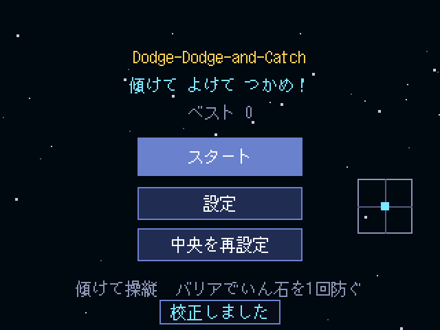
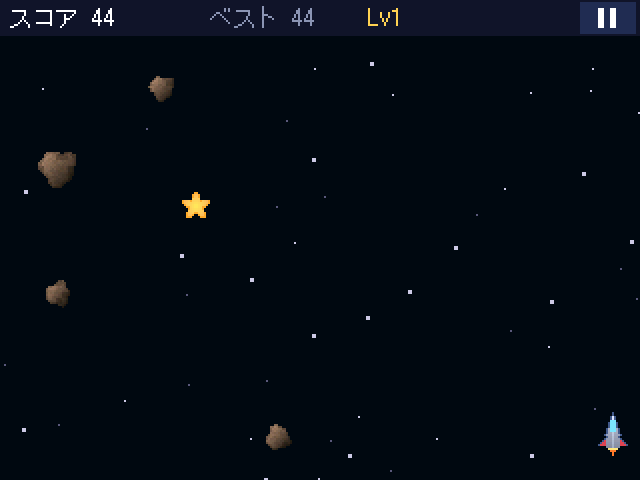
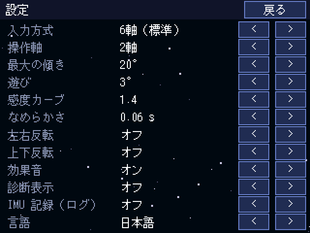
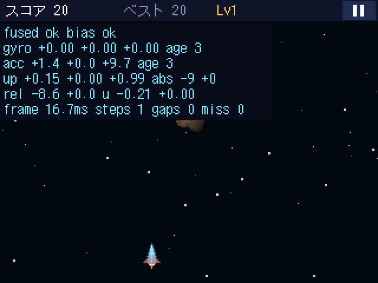

# Dodge-Dodge-and-Catch

GiiiCon（CoreS3 Lite）の本体を傾けて宇宙船を操縦し、上から降るいん石をよけながらアイテムをキャッチするゲーム。GiiiCon の IMU・入力・描画・音声 API をゲームで評価するデモ（Giiiz-Giiiz/GiiiCon#29）。

 

## 遊び方

1. 起動したら、いつもの持ち方で本体を静止させる。ジャイロのバイアスを測り、その姿勢を「中央」にする。
2. 「スタート」→ 3 秒のカウントダウン → 傾けた方向へ宇宙船が進む（左右の傾き＝横、前後の傾き＝縦）。
3. **バリア**（青い盾）をキャッチすると、いん石を 1 回防ぐ。8 秒で切れ、重ねて取ると 2 回分まで貯まる。**スター**は +50 点。
4. 右上の ‖ で一時停止。「中央を再設定」で持ち方を変えられる。HOME・スリープで自動的に一時停止し、再開はカウントダウンから。

設定：入力方式（6 軸／ジャイロのみ／加速度のみ／タッチ）、2 軸／左右のみ、最大の傾き、遊び（dead zone）、感度カーブ、なめらかさ、左右・上下反転、効果音、診断表示、IMU 記録、言語（日本語／English）。

 

## 入れる

- **Wi-Fi（おすすめ）**：GiiiCon 0.2.000 以降の本体で、Home の「ストア」から「Dodge-Dodge-and-Catch」を選んで入手する。
  公式ライブラリ [giii's mods](https://github.com/Giiiz-Giiiz/giii-s-mods) に載っている。新しい版はライブラリの詳細画面の「更新する」で入る。
- **USB**：[Releases](https://github.com/Giiiz-Giiiz/giii-s-mod_Dodge-Dodge-and-Catch/releases) の `dodge-dodge-and-catch-<版>.giii` を
  GiiiCon の tools で入れる：`giii install dodge-dodge-and-catch-0.1.1.giii --port <ポート>`

## 変更履歴

- **0.1.3**：Wi-Fi での更新の試験用（変更は版の表示だけ）
- **0.1.2**：タイトル画面の左上に版を表示（Wi-Fi での更新の確認用）
- **0.1.1**：Home のアイコンと説明文（GiiiCon 0.2.000 の manifest `icon`・`description`）。描画・入力・粒子の更新で
  毎フレームの table 生成をなくし、イベントを溜めないようにした（遊び方は同じ。同じ seed と入力で同じ展開）
- **0.1.0**：最初の版

## 開発

GiiiCon の checkout（既定 `../GiiiCon`、`giiicon.lock` の commit）と、その PC simulator が要る。

```sh
# GiiiCon 側で一度だけ
cmake -S . -B build/host -G Ninja && cmake --build build/host --target giii_sim

# このリポジトリで: 単体テスト・字形・lint・simulator のシナリオ
./scripts/check.sh                # GIIICON=/path/to/GiiiCon で場所を変えられる
./scripts/check.sh --shots /tmp/s # 各シナリオの画面を PNG で保存

# パッケージ化と実機導入（GiiiCon の tools から）
cd ../GiiiCon
uv run --project tools giii build ../giii-s-mod_Dodge-Dodge-and-Catch/app
uv run --project tools giii install ../giii-s-mod_Dodge-Dodge-and-Catch/app/dist/app.giii --port /dev/ttyACM0
uv run --project tools giii run dev.giiiz.dodge-dodge-and-catch --port /dev/ttyACM0
uv run --project tools giii logs --port /dev/ttyACM0
```

実機で「IMU 記録」をオンにすると、IMU の sample がログに出る。`scripts/log2trace.py` で simulator の sensor 記録に変換し、`giii sim app --sensors ...` で同じ操作を PC で再生できる。

## 構成

| パス | 内容 |
|---|---|
| `app/` | パッケージ本体（Lua、`manifest.json`）。`giii build` はこの下の `.lua` と `images/` だけを入れる |
| `app/images/icon.bmp` | Home のアイコン（96×96、`#ff00ff` は透明。manifest の `icon`）。`python3 scripts/make_icon.py [preview.bmp]` で作り直す |
| `app/ddc/world.lua` | ゲームの規則。60 Hz 固定 tick・自前の乱数で、seed と入力から同じ展開を再現する |
| `app/ddc/tilt.lua` | 傾き入力：バイアス校正 → 6 軸の姿勢推定 → 中立との差 → 論理入力 |
| `app/ddc/render.lua`, `art.lua` | 描画とスプライト（起動時に生成するオリジナル画像） |
| `tests/` | 単体テスト（`lua5.4 tests/run.lua`）と simulator のシナリオ（`tests/sim/run_sim.py`） |
| `docs/rules.md` | 規則・入力・診断の仕様 |
| `docs/api-gaps.md` | 制作中に見つかった OS／SDK の不足 |

## 現状

- 単体テスト（姿勢推定・規則・設定）と、PC simulator（本体と同じ Lua runtime）でのシナリオは通る。
- **実機では未確認**。ジャイロの軸と符号、遊びやすい感度、遅延、フレーム時間、音は実機で確かめる（Issue #3）。simulator の sensor 入力は記録の再生で、ジャイロの実機試験ではない。
